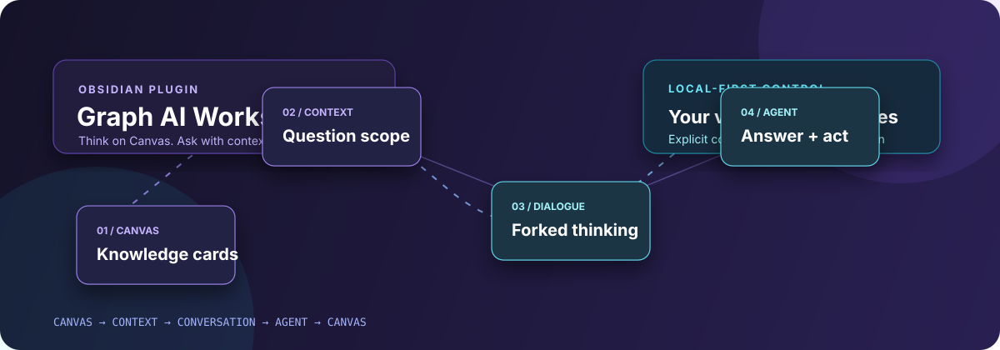
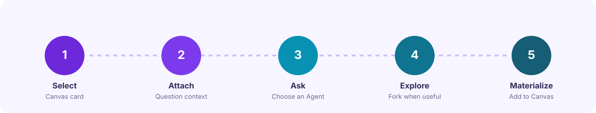

<div align="center">



# Graph AI Workspace

**A canvas-first AI workspace for Obsidian.**

[](https://github.com/netting-crypto/graph-ai-workspace/releases)
[](https://obsidian.md/)
[](LICENSE)
[](https://github.com/netting-crypto/graph-ai-workspace/actions/workflows/ci.yml)

[简体中文](README.zh-CN.md) · [Releases](https://github.com/netting-crypto/graph-ai-workspace/releases) · [Issues](https://github.com/netting-crypto/graph-ai-workspace/issues)

</div>

> **Status:** 0.9 beta · Desktop only · The data model and Agent adapters are still evolving.

Graph AI Workspace keeps **Canvas as the place where you organize and own knowledge**. Conversations are an exploration layer: bring exactly the material needed for one question into an Agent, then explicitly decide which result deserves a place back on the Canvas.

## Film

<video src="https://github.com/user-attachments/assets/50dd4644-ec10-4048-857a-4422b23568fc" controls width="100%"></video>

A 107-second product film with no narration — on-screen text and motion carry it. It moves through the problem, the three design principles, a Canvas conversation walkthrough (**Add to Canvas**, **Fork**, **Add + Fork**), the fork rules, and how local Agent runtimes and permissions fit in.

Slow to load? [Watch the film from the mirror](https://netting-crypto.github.io/videos/graph-ai-workspace-film.mp4).

## Why it is different

Most AI note tools turn your workspace into a chat transcript. Graph AI Workspace keeps the two jobs separate:

| Canvas | Conversation |
| --- | --- |
| Organize knowledge, write durable notes, and preserve relationships | Explore ideas, compare answers, and branch into new directions |
| Your long-lived structure | A temporary or forkable thinking layer |
| Receives only what you explicitly materialize | Uses only the context you explicitly attach |

## The workflow



1. Select a text or file card on an Obsidian Canvas.
2. Add cards, files, folders, images, or selected text as **question-level Context**.
3. Choose an Agent, model, reasoning level, and permission mode.
4. Ask the question; fork the Conversation when a new direction is useful.
5. Use **Add to Canvas** only when an answer is worth keeping as knowledge.

## Core capabilities

- **Canvas-first organization** — your Canvas stays a knowledge structure, not a transcript.
- **Independent Conversations** — one card can participate in many discussions, and one discussion can reference many cards.
- **Question-level Context** — attachments apply to the next question rather than silently binding to a whole conversation.
- **Conversation Forks** — branch from a specific point without duplicating the canonical history.
- **Explicit materialization** — write an Agent response back to Canvas with Markdown source and provenance preserved.
- **Streaming Agent UI** — see supported reasoning summaries, answer deltas, tool calls, edits, and artifacts as they arrive.
- **Runtime-backed controls** — discover supported models and reasoning options from the active runtime.
- **Image input** — paste, drag, or attach images when the selected Agent supports them.

## Supported Agent runtimes

Graph AI Workspace does not bundle a model. It connects to local runtimes already installed on your computer.

| Runtime | Integration | Notes |
| --- | --- | --- |
| **Codex** | Persistent App Server, with CLI fallback | Discover `codex` from `PATH` or configure its path in Settings |
| **OpenCode** | ACP, with CLI fallback | Models and reasoning options come from the ACP session when available |
| **ZCode** | CLI adapter | Experimental; primarily tested with the macOS desktop installation |

Different runtimes expose different capabilities. Graph AI maps them as closely as possible and does not promise stricter enforcement than the underlying runtime provides.

## Installation

### GitHub Release

After a release is published, download `main.js`, `manifest.json`, and `styles.css` from the matching version. Create this folder inside your vault:

```text
<Vault>/.obsidian/plugins/graph-ai-workspace/
```

Place the three files there, restart or reload Obsidian, then enable **Graph AI Workspace** under **Settings → Community plugins**.

### BRAT

Once a GitHub Release exists, add this repository to [BRAT](https://github.com/TfTHacker/obsidian42-brat) as a beta plugin and enable Graph AI Workspace in Obsidian.

## First-time setup

1. Install at least one supported Agent runtime.
2. Authenticate/configure that runtime using its own documented flow.
3. Open **Settings → Graph AI Workspace → Agent Runtime**.
4. Confirm executable paths, provider defaults, and the permission mode.
5. Open a Canvas and launch Graph AI from the ribbon or command palette.

### Commands

- **Open Graph AI sidebar** — open the workspace view.
- **Open Interaction Playground** — open the configured example Canvas, when available.
- **Refresh Agent runtimes** — re-detect installed backends and capabilities.

## Permissions and privacy

> **Read this before enabling local tools.** Permission labels are mapped to the selected runtime; they are not a security sandbox.

- **Read only** — ask the Agent not to modify the project.
- **Ask before changes** — request approval when the runtime supports interactive permission prompts.
- **Allow edits in project** — permit edits within the current vault/workspace.

Local conversations, context references, settings, and Agent session bindings are stored in the vault's local `data.json`. That file is intentionally ignored by Git and excluded from release builds. Manually entered API keys are stored there as well.

Graph AI Workspace includes no telemetry service. When you send a question, the prompt and the Context you supplied may be transmitted to the configured model provider or local Agent. Local Agent processes may access the vault according to the selected permission mode. Review the provider and runtime policies before using private material.

## Development

Requirements: **Node.js 20+** and npm.

```bash
npm ci
npm run check
npm run build
node --check dist/main.js
```

The production bundle is written to `dist/`:

```text
dist/
├── main.js
├── manifest.json
└── styles.css
```

Do not commit `data.json`, `.env*`, local Agent credentials, private vault content, `node_modules/`, or generated `dist/` output.

## Releasing

1. Update the semantic version in `manifest.json`, `package.json`, and `versions.json`.
2. Run `npm run release:verify`.
3. Commit the changes and create a matching tag:

```bash
git tag v0.9.0
git push origin main --tags
```

The release workflow validates the tag and publishes `main.js`, `manifest.json`, and `styles.css` as GitHub Release assets.

## Contributing

Issues and pull requests are welcome. Before contributing, please keep changes focused, avoid including vault data or credentials, and run the local checks above.

## License

MIT — see [LICENSE](LICENSE).
